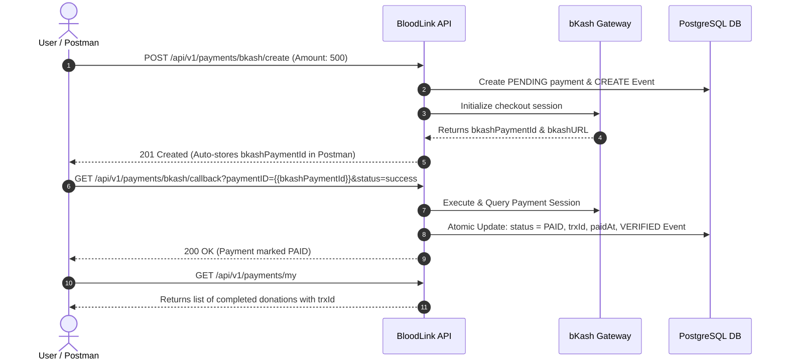

# 🩸 BloodLink - Automated Blood Donation & Emergency Coordination Backend

<p align="center">
  
  
  
  
  
  
  
  
  
</p>

---

## 🌐 Live Deployment & Base URLs

| Resource | URL |
|---|---|
| **Live API Base URL (Vercel)** | `https://blood-link-backend-one.vercel.app/api/v1` |
| **Server Health Check** | `https://blood-link-backend-one.vercel.app/health` |
| **GitHub Repository** | `https://github.com/mdratul4505/BloodLink-backend.git` |
| **Local Development URL** | `http://localhost:5000/api/v1` |

---

## 🔑 Default Administrator Credentials

Use these seeded admin credentials to test protected administrative endpoints (User suspension, Organization approval, Audit logs, and Payment histories):

| Role | Email | Password |
|---|---|---|
| **SUPER ADMIN / ADMIN** | `admin@bloodlink.org` | `Admin@123456` |

---

## 📖 Project Overview

**BloodLink** is an enterprise-grade backend infrastructure designed to bridge the gap between voluntary blood donors, emergency patients, hospitals, and voluntary blood donation organizations. Built with **Express 5**, **TypeScript**, **Prisma ORM 7**, **PostgreSQL**, **Redis**, **Nodemailer (Gmail SMTP)**, and **bKash Tokenized Checkout**, BloodLink streamlines:

1. **Life-Saving Emergency Matching**: Instant notification broadcast to nearby eligible donors matching blood group and geographical proximity (District & Upazila).
2. **OTP-Verified Onboarding**: Safe registration with 6-digit email OTP verification preventing bots and fake accounts.
3. **Dual JWT Authentication**: Short-lived Access Token (1 Day) paired with secure Refresh Token (7 Days) and token blacklisting on logout.
4. **Transparent Organization Verification**: Multi-step verification workflow for blood banks and hospitals with flexible status transitions (`APPROVED`, `ACCEPT`, `EXCEPT`, `REJECTED`).
5. **Atomic Donation Management**: Prisma `$transaction` ensures that completing a donation atomically updates donor response, decrements required units, recalculates requester blood status, and logs donor eligibility.
6. **Integrated bKash Payment Gateway**: Enables voluntary donor contributions and emergency fund collection with webhook callbacks, signature checks, amount validation, and idempotency protection.

---

## 🌟 Core Features & Modules

### 1. 🔐 Security & Email OTP Verification
- **Registration OTP**: When registering with email, a 6-digit numeric OTP is dispatched via Nodemailer Gmail SMTP (10-minute expiry). The account remains inactive until OTP verification (`POST /api/v1/auth/verify-email`).
- **Resend OTP**: Users can request a fresh OTP if they haven't received it (`POST /api/v1/auth/resend-verification-otp`).
- **Dual JWT Tokens**: Login returns `accessToken` (1d validity) and `refreshToken` (7d validity).
- **Forgot Password**: OTP-based password reset cycle (`forgot-password` -> `verify-otp` -> `reset-password`) with automated confirmation emails.
- **Role-Based Access Control (RBAC)**: Enforced via `auth("ADMIN", "ORGANIZATION", "USER")` middleware.

### 2. 🩸 Blood Request & Atomic Donation
- **Nearby Donor Alert**: Creating a request automatically filters matching blood groups and locations, dispatching in-app alerts and notifications.
- **Donor Responses**: Donors can mark their willingness (`AVAILABLE` / `UNABLE`).
- **Atomic `$transaction` Execution**: When the requester completes a donation, Prisma atomically:
  - Records the donation in `Donation` table.
  - Updates `DonorResponse` status to `DONATED`.
  - Recalculates remaining blood units needed.
  - Updates `BloodRequest` status to `PARTIALLY_FULFILLED` or `FULFILLED`.
  - Updates donor profile last donated date and donor badge count.

### 3. 🏢 Organization Management & Verification
- Organizations submit license and registration credentials.
- System Admin verifies or rejects applications (`PATCH /api/v1/admin/organizations/:id/verify`).
- Lenient API design accepts `"APPROVED"`, `"ACCEPT"`, `"EXCEPT"`, or `"AXCEPT"`, mapping them reliably to the canonical `APPROVED` state.

### 4. 💳 bKash Payment Gateway (Voluntary Platform Support)
- Built on bKash Tokenized Checkout API (v1.2.0-beta).
- **Session Creation**: Generates unique merchant invoice number, grants token, caches token in Redis with TTL, and stores `PENDING` payment with audit event.
- **Callback & Verification**: Validates `status`, executes payment session, calls bKash Query API to verify paid amount against database record, updates status to `PAID`, records `trxId`, and emits `VERIFIED` audit log.
- **Idempotency Protection**: Repeated callback calls safely return existing paid status without double execution or errors.
- **Fallback Simulation**: If live sandbox credentials are being set up, a simulated mock payment session runs out of the box so end-to-end flows never fail.

### 5. 👤 Universal Profile & HD Picture Upload
- Any authenticated user can view and update their profile (`GET /users/me`, `PATCH /users/me`).
- High-definition avatar upload supporting up to 15MB (`.jpg`, `.jpeg`, `.png`, `.webp`, `.gif`) via `POST /api/v1/users/avatar`.
- On Vercel serverless, uploads are seamlessly handled via `/tmp/uploads` with automatic fallback.

---

## 🛠️ Technology Stack

| Technology | Purpose |
|---|---|
| **Node.js 20+** | JavaScript runtime |
| **TypeScript 5.x** | Strongly typed backend development |
| **Express 5.x** | High performance REST API framework |
| **Prisma ORM 7.10** | Database ORM with multi-file schema architecture |
| **PostgreSQL 16** | Relational primary database |
| **Redis 6+** | In-memory cache for OTPs, rate-limiting, and tokens |
| **Nodemailer** | Gmail SMTP transactional email provider |
| **bKash PGW API** | Tokenized payment checkout gateway |
| **Zod** | Runtime schema validation |
| **Tsup** | Ultra-fast TypeScript bundler |
| **Vercel Serverless** | Global production deployment |

---

## 💳 How to Test bKash Payment in Postman

We have fully automated the bKash payment verification flow in our Postman Collection. Follow these 4 easy steps:



### Official bKash Developer Portal Sandbox Credentials:

| Field | Sandbox Test Value |
|---|---|
| **Test Wallet Number** | `01770618575` (or `01877722345`, `01929918378`) |
| **bKash Verification Code (OTP)** | `123456` |
| **bKash PIN** | `12121` |
| **bKash App Key** | `4f6o0cjiki2rfm34kfdadl1eqq` |
| **bKash App Secret** | `2is7hdktrekvrbljjh44ll3d9l1dtjo4pasmjvs5vl5qr3fug4b` |
| **bKash Username** | `sandboxTokenizedUser02` |

---

### Step-by-Step Payment Testing (Real bKash Portal UI):

1. **Step 1: Login to get Access Token**
   - Run `POST /api/v1/auth/login` (or `POST /api/v1/auth/register`).
   - The test script automatically saves `{{accessToken}}` to collection variables.

2. **Step 2: Create Payment Session**
   - Open folder `6. bKash Payment (Voluntary Support)` -> `POST Create bKash Payment`.
   - Body:
     ```json
     {
       "amount": 500,
       "purpose": "PLATFORM_SUPPORT",
       "payerReference": "01770618575"
     }
     ```
   - Click **Send**.
   - The response returns a real **`bkashURL`** from bKash Developer Portal:
     ```json
     {
       "success": true,
       "data": {
         "paymentId": "uuid...",
         "bkashPaymentId": "TR0011pk0rEmg1792091634596",
         "bkashURL": "https://sandbox.payment.bkash.com/?paymentId=TR0011pk0rEmg1792091634596&hash=..."
       }
     }
     ```

3. **Step 3: Open `bkashURL` in Browser & Pay with Real bKash UI**
   - Copy and paste the returned **`bkashURL`** in your browser.
   - You will see the official **bKash Payment Screen**:
     - **Enter Wallet Number**: `01770618575` -> Click **Confirm**
     - **Enter Verification Code (OTP)**: `123456` -> Click **Confirm**
     - **Enter PIN**: `12121` -> Click **Confirm**
   - bKash authorizes the payment and automatically redirects to your callback URL!

4. **Step 4: Verify Transaction & Status**
   - In Postman, run `GET My Payments` (`{{baseUrl}}/payments/my`).
   - You will see your payment status marked as **`PAID`** with the official bKash **`trxId`**, amount, and `paidAt` timestamp!

---

## 📋 Comprehensive API Endpoints (40+ Endpoints)

### 1. Authentication & Security (`/api/v1/auth`)
| Method | Endpoint | Description | Access |
|---|---|---|---|
| `POST` | `/auth/register` | Register new user (Sends 6-digit OTP email) | Public |
| `POST` | `/auth/verify-email` | Verify email OTP to activate account | Public |
| `POST` | `/auth/resend-verification-otp` | Resend registration OTP email | Public |
| `POST` | `/auth/login` | Login (Returns `accessToken` + `refreshToken`) | Public |
| `POST` | `/auth/google` | Google OAuth registration / login | Public |
| `POST` | `/auth/refresh-token` | Generate fresh access token from refresh token | Public |
| `POST` | `/auth/logout` | Invalidate session & blacklist token | Authenticated |
| `POST` | `/auth/forgot-password` | Send password reset OTP | Public |
| `POST` | `/auth/verify-otp` | Verify password reset OTP | Public |
| `POST` | `/auth/reset-password` | Reset password using verified OTP | Public |
| `POST` | `/auth/change-password` | Change password for logged-in user | Authenticated |

### 2. User & Profile (`/api/v1/users`)
| Method | Endpoint | Description | Access |
|---|---|---|---|
| `GET` | `/users/me` | Get logged-in user profile & donor info | Authenticated |
| `PATCH` | `/users/me` | Update profile information | Authenticated |
| `POST` | `/users/avatar` | Upload HD profile picture (up to 15MB) | Authenticated |
| `PATCH` | `/users/availability`| Toggle blood donor availability status | Authenticated |

### 3. Donors Directory (`/api/v1/donors`)
| Method | Endpoint | Description | Access |
|---|---|---|---|
| `GET` | `/donors` | Filter donors by blood group, district, upazila | Public (Cached) |
| `GET` | `/donors/:id` | Fetch specific donor profile and stats | Public |

### 4. Emergency Blood Requests (`/api/v1/blood-requests`)
| Method | Endpoint | Description | Access |
|---|---|---|---|
| `POST` | `/blood-requests` | Create emergency blood request & alert donors | Authenticated |
| `GET` | `/blood-requests` | Filter requests by blood group, status, location | Public |
| `GET` | `/blood-requests/my-requests` | List user's created blood requests | Authenticated |
| `GET` | `/blood-requests/:id` | View request details and donor responses | Public |
| `PATCH` | `/blood-requests/:id` | Update blood request details | Creator / Admin |
| `DELETE`| `/blood-requests/:id` | Cancel emergency blood request | Creator / Admin |
| `POST` | `/blood-requests/:id/respond` | Respond as donor (`AVAILABLE` / `UNABLE`) | Donor |
| `GET` | `/blood-requests/:id/responses`| View all responses submitted for request | Creator / Admin |
| `POST` | `/blood-requests/:id/complete-donation` | Atomic donation completion transaction | Creator / Admin |

### 5. Organizations (`/api/v1/organizations`)
| Method | Endpoint | Description | Access |
|---|---|---|---|
| `POST` | `/organizations` | Apply for organization registration | Authenticated |
| `GET` | `/organizations` | List verified organizations | Public |
| `GET` | `/organizations/:id` | View organization profile and donation camps | Public |
| `PATCH` | `/organizations/:id` | Update organization profile details | Org Owner / Admin |

### 6. Donation Camps (`/api/v1/camps`)
| Method | Endpoint | Description | Access |
|---|---|---|---|
| `POST` | `/camps` | Create new donation camp | Org / Admin |
| `GET` | `/camps` | List upcoming and ongoing donation camps | Public |
| `GET` | `/camps/:id` | View camp details and registrations | Public |
| `POST` | `/camps/:id/register` | Register as participant in donation camp | Authenticated |
| `PATCH` | `/camps/:id/status` | Update camp status (`UPCOMING`, `ONGOING`, `COMPLETED`)| Org / Admin |

### 7. Notifications (`/api/v1/notifications`)
| Method | Endpoint | Description | Access |
|---|---|---|---|
| `GET` | `/notifications` | Fetch user notifications | Authenticated |
| `PATCH` | `/notifications/:id/read` | Mark individual notification as read | Authenticated |
| `PATCH` | `/notifications/read-all` | Mark all notifications as read | Authenticated |

### 8. bKash Payments (`/api/v1/payments`)
| Method | Endpoint | Description | Access |
|---|---|---|---|
| `POST` | `/payments/bkash/create` | Initialize checkout payment session | Authenticated |
| `GET` | `/payments/bkash/callback` | Gateway webhook callback (Execute & Verify) | Public (Gateway) |
| `GET` | `/payments/my` | View logged-in user donation history | Authenticated |
| `GET` | `/payments/:id` | View transaction details and event logs | Authenticated |

### 9. Administration (`/api/v1/admin`)
| Method | Endpoint | Description | Access |
|---|---|---|---|
| `GET` | `/admin/users` | List and search all users | ADMIN |
| `PATCH` | `/admin/users/:id/status` | Suspend or reactivate user account | ADMIN |
| `PATCH` | `/admin/organizations/:id/verify` | Verify organization (`APPROVED`, `EXCEPT`, `REJECTED`)| ADMIN |
| `GET` | `/admin/dashboard-stats` | Aggregated metrics and system summary | ADMIN (Cached) |
| `GET` | `/admin/audit-logs` | Platform audit logs | ADMIN |
| `GET` | `/admin/payments` | All transactions and audit trails | ADMIN |

---

## 🧪 Postman Collection Setup

1. Open Postman.
2. Click **Import** (top left).
3. Choose the [`postman_collection.json`](postman_collection.json) file located in this repository.
4. **Pre-configured Variables**:
   - `baseUrl`: `https://blood-link-backend-one.vercel.app/api/v1` (Default)
   - `localBaseUrl`: `http://localhost:5000/api/v1` (For local testing)
   - `adminEmail`: `admin@bloodlink.org`
   - `adminPassword`: `Admin@123456`
   - `accessToken`: (Auto-saved upon login/registration)
   - `adminAccessToken`: (Auto-saved upon admin login)
   - `bkashPaymentId`: (Auto-saved upon payment create)
   - `paymentId`: (Auto-saved upon payment create)

All endpoints will instantly work with the live Vercel URL out of the box!

---

## 🚀 Local Installation & Setup

```bash
# 1. Clone repository
git clone https://github.com/mdratul4505/BloodLink-backend.git
cd BloodLink-backend

# 2. Install dependencies
npm install

# 3. Generate Prisma client
npx prisma generate

# 4. Push schema to database
npx prisma db push

# 5. Start dev server
npm run dev

# 6. Build project
npm run build
```

---

## 📄 License
This project is licensed under the [ISC License](LICENSE).
